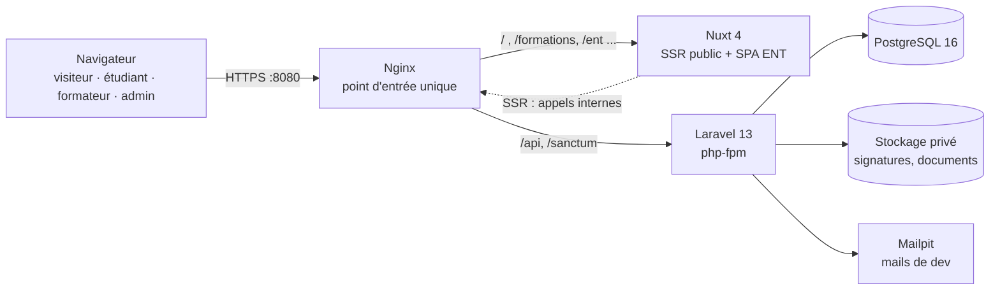
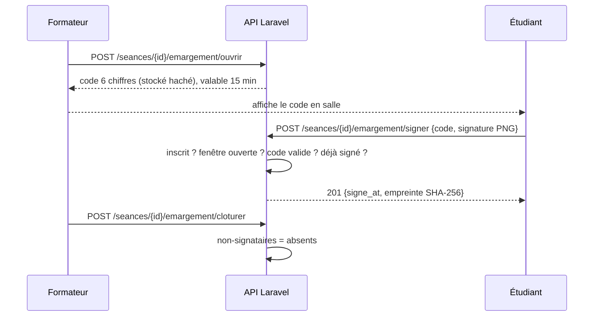

# 2. Architecture technique

## 2.1 Stack retenue

| Couche | Choix | Pourquoi |
|---|---|---|
| API | **Laravel 13** (PHP 8.3+) | Migrations, validation, files d'attente, tests intégrés ; écosystème sécurité officiel |
| Authentification | **Sanctum** (session par cookie httpOnly + CSRF) + **Fortify** (MFA TOTP, RFC 6238) | Pas de jeton stocké en `localStorage` (protection XSS) ; MFA réelle avec codes de secours |
| RBAC | Tables `roles` / `permissions` / `permission_role` + middleware `permission:` | Matrice lisible et testée (`RbacSeeder::MATRICE`) |
| Front | **Nuxt 4** (Vue 3) | Rendu serveur des pages publiques (SEO) ; application cliente pour l'ENT |
| Base de données | **PostgreSQL 16** | Types stricts (`date`, `time`), contraintes, intégrité ; tests aussi exécutés sur SQLite |
| PDF | dompdf | Attestations d'assiduité |
| Documentation API | OpenAPI 3.0.3 (`backend/public/openapi.json`) + Swagger UI (`/api/docs`) | Un test vérifie que chaque route est documentée |
| Conteneurs | Docker Compose : postgres, php-fpm, node, nginx, mailpit | Une seule commande pour lancer la plateforme |

**WordPress abandonné** pour le catalogue : les facettes exigent des données structurées (niveau RNCP, CPF, filière). Garder WordPress ajouterait un second backend et une seconde surface d'attaque.

## 2.2 Vue d'ensemble



Front et API partagent **la même origine** : cookies de session `HttpOnly` + `SameSite=Lax` + jeton CSRF, sans configuration CORS.

## 2.3 Découpage du backend

```
backend/app/
├── Http/Controllers/Api/   Catalogue, Candidature, Planning, Emargement, Assiduite, Note, Examen, Document, Admin, Me
├── Http/Middleware/        EnsurePermission (RBAC), EnsureMfaEnrolled (MFA obligatoire par rôle)
├── Http/Requests/          Validation stricte (candidature, contact, signature)
├── Services/               EmargementService (cœur métier), AssiduiteService (indicateurs), MessagerieService (périmètres, groupes, non-lus)
├── Support/                HtmlAssainisseur (liste blanche HTML pour le contenu importé)
├── Console/Commands/       blog:import-wordpress (migration du blog via l'API REST WordPress)
├── Models/                 19 modèles Eloquent
└── Exceptions/             EmargementException → réponse 422 avec un code métier
```

## 2.4 Sécurité

| Menace | Mesure |
|---|---|
| Vol de mot de passe | MFA TOTP **obligatoire** pour admin et formateur (`MFA_OBLIGATOIRE_POUR`) ; codes de secours |
| Force brute | 5 tentatives / min (connexion et MFA) ; 5 envois / min / IP sur les formulaires publics |
| Élévation de privilèges | RBAC par permission sur chaque route, plus un contrôle du périmètre (un formateur ne voit que ses promotions) |
| XSS / vol de session | Cookie httpOnly chiffré, CSRF, aucun jeton côté JavaScript |
| Injection | ORM avec requêtes préparées, FormRequest, liste blanche des types de fichiers |
| Robots | Pot de miel sur les formulaires publics |
| Fraude à l'émargement | Code à 6 chiffres haché, fenêtre de 15 min, unicité (séance, étudiant) en base, empreinte SHA-256 |
| Fuite de données | Signatures et documents hors du dossier public ; secrets uniquement dans `.env` (non versionné) |
| Fichier `67.php` | Vide, à la racine du dépôt ; Nginx ne sert que `backend/public` : il n'est jamais exécutable |

## 2.5 Émargement : séquence



Empreinte = `SHA-256(seance | étudiant | horodatage ISO | SHA-256(image))`. Toute modification ultérieure est détectée par `GET /emargements/{id}/verification`. Il s'agit d'une **signature électronique simple** au sens du règlement eIDAS.

## 2.6 Stratégie de tests

81 tests (PHPUnit), exécutés sur **SQLite** (rapide) et **PostgreSQL** (cible) :

| Suite | Contenu |
|---|---|
| `EmargementTest` (16) | Ouverture, propriétaire, jour J, code faux, fenêtre expirée, double signature, PNG invalide, clôture, intégrité, PDF |
| `AuthMfaTest` (12) | Session, MFA obligatoire, second facteur, compte désactivé, force brute |
| `RbacTest` (8) | Matrice complète des permissions, cloisonnement des données |
| `CatalogueTest` (9), `CandidatureTest` (6) | Facettes, validation stricte, RGPD, pot de miel, limitation de débit |
| `AssiduiteEtExamensTest` (7) | Taux et alertes, jury, grilles, notes, documents |
| `MessagerieTest` (11) | Périmètre des contacts, conversation unique par paire, non-lus, accès réservé aux participants, groupes réservés aux formateurs, gestion des membres |
| `ContenuTest` (6) | FAQ, blog (tri, filtre, suggestions), formation continue, assainissement HTML, import WordPress simulé |
| `OpenApiTest` (3) | Chaque route de l'API est documentée |
| `EmpreinteTest` (3, unitaires) | Déterminisme et sensibilité de l'empreinte |
