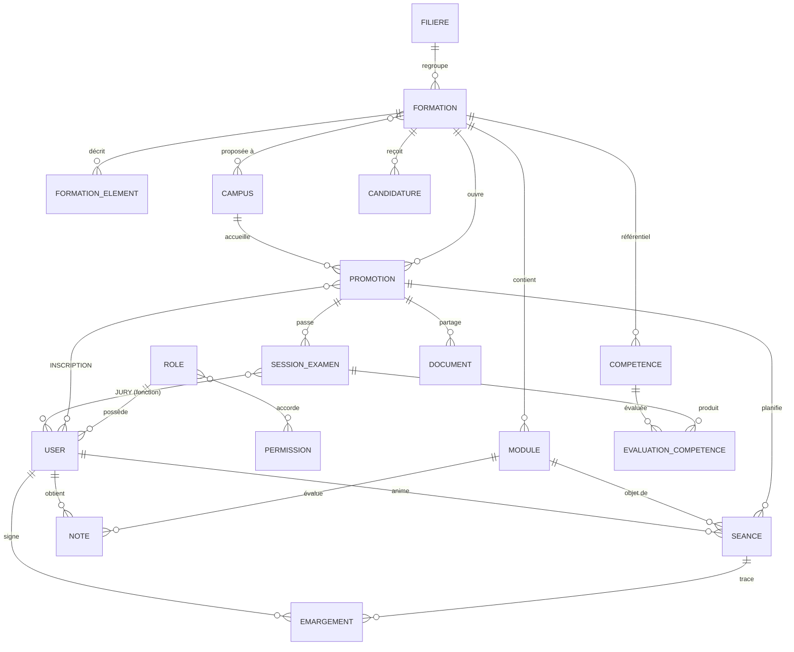

# 3. Modèle de données (3NF)

## 3.1 MCD (vue entités-associations)

## 3.2 MLD (tables principales)

| Table | Clé | Colonnes clés | Contraintes |
|---|---|---|---|
| roles | id | code (unique), libelle | |
| permissions | id | code (unique), libelle | |
| permission_role | (role_id, permission_id) | | FK × 2 |
| users | id | role_id, prenom, nom, email (unique), password, actif, two_factor_* | FK role |
| filieres | id | code (unique), libelle | |
| formations | id | filiere_id, slug (unique), intitule, niveau_rncp, code_rncp, eligible_cpf, rythme, prochaine_rentree, publiee | index (filiere, niveau, cpf) |
| formation_elements | id | formation_id, type, ordre, contenu | 1NF : objectifs, prérequis, débouchés, modalités sont des lignes, pas une liste dans une colonne |
| campus / formation_campus | id / (formation_id, campus_id) | | |
| promotions | id | formation_id, campus_id, libelle, date_debut, date_fin | |
| inscriptions | id | promotion_id, user_id, date_inscription | UNIQUE (promotion, user) |
| modules | id | formation_id, code, intitule, volume_horaire | UNIQUE (formation, code) |
| seances | id | promotion_id, module_id, formateur_id, date, creneau, heures, code_emargement_hash, emargement_ouvert_at / expire_at, cloturee_at | UNIQUE (promotion, date, créneau) |
| emargements | id | seance_id, user_id, statut, signe_at, signature_path, empreinte, ip | **UNIQUE (seance, user)** |
| notes | id | module_id, etudiant_id, formateur_id, valeur, coefficient, date_evaluation | |
| sessions_examen | id | promotion_id, intitule, debut, fin, lieu | |
| jury_membres | (session_examen_id, user_id) | fonction | |
| competences | id | formation_id, code, libelle | UNIQUE (formation, code) |
| evaluations_competence | id | session, etudiant, competence, evaluateur, niveau | UNIQUE (session, étudiant, compétence) |
| documents | id | promotion_id, module_id, auteur_id, titre, chemin, mime, taille | |
| candidatures / messages_contact | id | données du formulaire + consentement_rgpd_at | |
| conversations | id | type (privee/groupe), nom, createur_id, promotion_id, cle_privee | UNIQUE (cle_privee) : une seule conversation privée par paire |
| conversation_participants | (conversation_id, user_id) | role (gestionnaire/membre), dernier_lu_id | calcul des non-lus sans compteur stocké (3NF) |
| messages | id | conversation_id, auteur_id, contenu | index (conversation, id) |
| faq_questions / articles | id | question, reponse, theme / slug, titre, resume, contenu, categorie, publie_le | UNIQUE (slug) |
| fc_domaines / fc_stages | id | slug, libelle, icone / fc_domaine_id, intitule | UNIQUE (domaine, intitulé) |

## 3.3 Justification 3NF

- **1NF** : aucune valeur multiple dans une colonne (les listes de la fiche formation sont dans `formation_elements`).
- **2NF** : les tables d'association (`permission_role`, `jury_membres`) n'ont que des attributs qui dépendent de toute la clé (la `fonction` dépend du couple session + membre).
- **3NF** : aucune dépendance transitive. Le libellé « Bac+2 » n'est pas stocké : il est **calculé** à partir de `niveau_rncp`. Le taux d'assiduité n'est pas stocké : il est **calculé** à partir des émargements.

Migrations versionnées : `backend/database/migrations/` (4 migrations métier).
